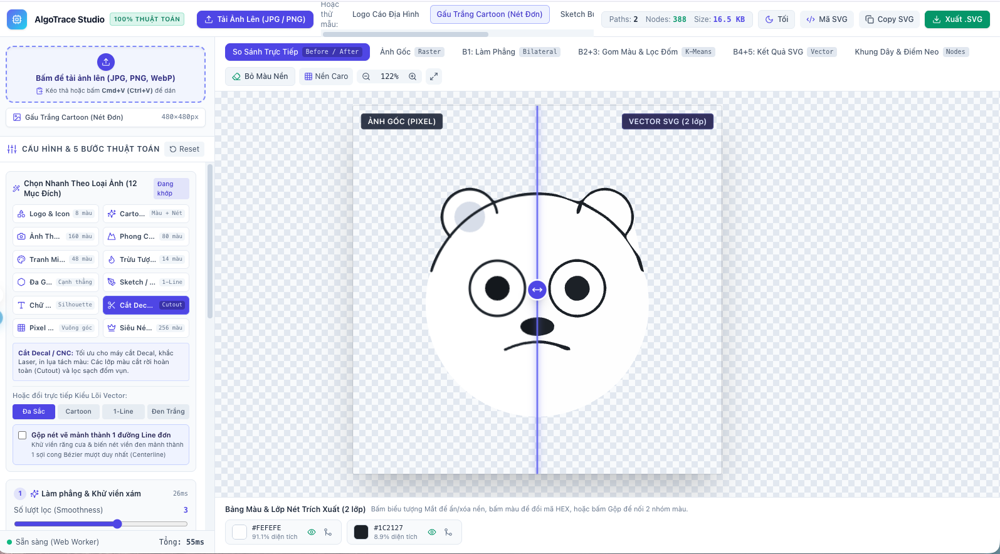

# Image to SVG Vectorizer

A web application that converts raster images into SVG vector graphics. Upload an image, adjust the vectorization settings, and preview the result in the browser.

## Screenshot



## Features

- Upload JPG, PNG, WebP, BMP, and GIF images; drag and drop or paste images from the clipboard.
- Try built-in sample images and presets for different use cases.
- Adjust the color count, smoothing, simplification, speckle removal, and layer settings.
- Compare the source image with the result, customize the palette, and copy or download the SVG.
- Switch between light and dark themes.

## Getting started

Requires Node.js and npm.

```bash
npm install
npm run dev
```

Other commands:

```bash
npm run build    # Type-check and create a production build in dist/
npm run preview  # Preview the production build
```

## Tech stack

React, TypeScript, Vite, and Tailwind CSS. Image processing runs in a Web Worker to keep the interface responsive while settings change.
